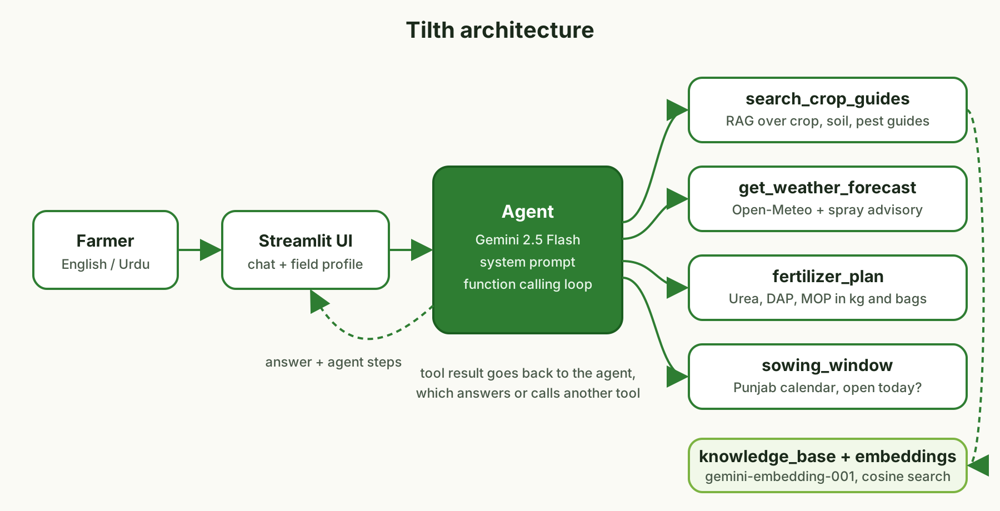

# 🌾 Tilth

**A crop advisor agent for Punjab farmers.** Ask a farming question in English, Urdu or Roman Urdu and the agent decides which tools to use: crop guides (RAG), live weather, a fertilizer calculator and sowing calendars, then answers in simple steps.

> *Tilth (noun): the condition of tilled soil, ready for a crop.*

**Live demo:** _add your Streamlit link here_

---

## **Why this exists**

Farming advice is scattered across PDFs, WhatsApp forwards and half-remembered tips. Tilth puts it in one chat and makes the model **show its work**: every answer comes with the tools it called, so the advice can be checked instead of trusted blindly.

## **What it does**

- **Understands the question** and asks for a missing detail (crop, acres, city) instead of guessing
- **Searches crop guides** with RAG for diseases, pests, irrigation and soil
- **Checks live weather** before advising on spraying or irrigation
- **Calculates fertilizer** in kg and 50 kg bags (Urea, DAP, MOP) for any field size
- **Tells you the sowing window** and whether it is open today
- **Replies in your language** and keeps safety notes for pesticides
- **Remembers your field** (city, crop, acres) from the sidebar so you do not repeat yourself
- **Shows agent steps** in the UI: tool name, arguments and raw results
- **Handles errors calmly**: busy API retry, invalid key and quota messages

## **Architecture**



**Agent loop:** understand the question, choose a tool, run it, read the result, answer (and repeat if another tool is needed).

## **How the GenAI pieces fit**

| Requirement | Where it lives |
|---|---|
| LLM API integration | `agent.py` (Gemini via `google-genai`) |
| Prompt engineering | `SYSTEM_PROMPT` in `agent.py`: role, steps, tool rules, language, safety |
| RAG | `rag.py` + `knowledge_base/` (chunk by section, embed, cosine retrieval, keyword fallback) |
| Tools / function calling | `tools.py` (four typed functions the model calls on its own) |
| Agent behaviour | Multi-step tool use with a visible trace in `app.py` |

## **Tech stack**

Python · Streamlit · Google Gemini (`gemini-2.5-flash`, `gemini-embedding-001`) · NumPy · Open-Meteo API · pytest

## **Run it locally**

```bash
git clone https://github.com/MariaZafar22/Tilth.git
cd Tilth
python -m venv .venv
.venv\Scripts\activate        # Windows (macOS/Linux: source .venv/bin/activate)
pip install -r requirements.txt
copy .env.example .env        # then paste your Gemini API key inside
streamlit run app.py
```

## **Deploy (Streamlit Community Cloud)**

1. Push this repo to GitHub.
2. On share.streamlit.io choose **New app**, pick the repo and `app.py`.
3. In **Advanced settings > Secrets** add: `GEMINI_API_KEY = "your_key"`
4. Deploy and copy the public link.

## **Project structure**

```
Tilth/
├── app.py                 # Streamlit chat UI + agent trace
├── agent.py               # Gemini client, system prompt, tool loop
├── tools.py               # weather, fertilizer, sowing, RAG tool
├── rag.py                 # chunking, embeddings, retrieval
├── knowledge_base/        # crop, soil and pest guides (markdown)
├── docs/                  # architecture diagram (png + svg)
├── tests/                 # offline tests: tools, retrieval, agent trace
├── requirements.txt
└── .env.example
```

## **Tests**

```bash
python -m pytest -q
```

## **Limits and safety**

- Fertilizer rates are **indicative** and based on common Punjab recommendations; confirm with a soil test.
- The agent never invents pesticide doses. It points to the product label and the local agriculture extension officer.
- The knowledge base is small on purpose; extend it by dropping new `.md` files into `knowledge_base/`.

## **Ideas for next**

Mandi price tool, Urdu voice input, photo-based leaf diagnosis, and WhatsApp delivery.

---

**Built by Maria Zafar.** Good crops start with good questions. 🌱
